# Spectre Prism for core 0.4

Select the model profile for generation, classification or embeddings without
mixing provider configuration into application handlers. Prism installs into
`Spectre.Stack`; the Agent declares recognition and the Server coordinates
requests and results. Different tasks may use different models, and custom
selectors/providers remain supported.

[Documentation index](docs/INDEX.md) · [Migrate from core 0.3](docs/MIGRATING_TO_SPECTRE_0_4.md)



[Diagram source](docs/assets/readme-architecture.mmd).

`generate` routes the actual request to a model. The optional `prism` helper
only inspects a selection and does not make a provider call.

## Installation

Add the packages to your application:

```elixir
defp deps do
  [
    {:spectre, "~> 0.4.0"},
    {:spectre_prism, "~> 0.1.0"}
  ]
end
```

For sibling checkouts, replace these with `path: "../spectre"` and
`path: "../spectre_prism"` dependencies. Package integration tests use
`SPECTRE_PATH=../spectre mix test`.

Prism depends on Spectre. Its direct provider/selection APIs remain available,
but it is not a framework-independent standalone package. Provider credentials
belong to host environment/runtime configuration, not to prompts or checkpoints.

## Stack → Agent → Server

```elixir
defmodule MyApp.AnswerAI do
  use Spectre.Stack
  install Spectre.Prism do
    provider(:openai)
    default(:balanced)
  end
end

defmodule MyApp.AnswerServer do
  use Spectre.Server, tools: MyApp.AnswerAI, prompt_root: "priv/answer/prompts"

  def handle_flow({:answers, :question}, _input, ctx),
    do: generate(ctx, :answer, on_result: :answer)

  def handle_result(:answer, {:generated, response}, ctx),
    do: respond(ctx, response.text)

  def handle_result(tag, result, ctx), do: super(tag, result, ctx)
end

defmodule MyApp.AnswerAgent do
  use Spectre.Agent, stack: MyApp.AnswerAI, server: MyApp.AnswerServer
  flow :answers do
    on(:question, regex: ~r/\S/)
  end
end
```

Create `priv/answer/prompts/answer.eex` and configure provider credentials in
the host. Start the Server and send an input:

```elixir
{:ok, server} = Spectre.Server.start_link(agent: MyApp.AnswerAgent, consumer: self())
{:ok, interaction} = Spectre.Server.input(server, "Explain pattern matching")
```

Prism does not need its own Stack process for remote providers. A local Nx serving is separately
supervised and registered by name, as shown in the [provider guide](docs/PROVIDERS.md).

Generation selects the model automatically. To inspect a selection separately,
use the generated helper in a callback:

```elixir
prism(ctx, %{purpose: :response_generation}, on_result: :selected)
# handle_result(:selected, {:selected, summary}, ctx)
```

Selection is introspection: it does not call a model or pin a later generation.
The package does not export `prism/3` for import.

## Models, routing and results

Prism's ordinary extension continues to serve core generation, classification
and embedding. `provider`, `model`, `purpose`, `default` and `selector` remain
Stack configuration. A classifier may use a separate model or an application
adapter; installing Prism does not train local classifier artifacts or replace
semantic-cache collection/training.

The helper accepts `%{purpose: purpose, constraints: ..., modalities: ...}`
(with optional constraint/modality fields), or `{:select, request}`. It returns
`{:selected, summary}` with public selection information, never executable
model bindings or credentials. Custom selectors receive the same route, memory,
assigns and normalized input context as generation. Errors arrive through the
named `handle_result/3`; cognitive selection is repeatable after recovery.


## Provider setup and compatibility

- [Provider catalogs, custom adapters and local models](docs/PROVIDERS.md)
- [0.4 migration and helper contract](docs/MIGRATING_TO_SPECTRE_0_4.md)
- [Public API contract](docs/PUBLIC_API.md)
- [Historical Instance integration](docs/LEGACY_0_3.md)
- [Changes](CHANGELOG.md)

## Runtime and examples

The generated `prism` helper also works in [Skill Server callbacks](https://github.com/elchemista/spectre/blob/0.4.0/docs/SKILLS.md).
Skills share the root's GAM Domain; enable governed operations on the root and
allow them in the mount's `governed:` references. The
[core tool guide](https://github.com/elchemista/spectre/blob/0.4.0/docs/STACK_TOOLS.md) covers scheduling and recovery;
[Managed GAM](https://github.com/elchemista/spectre/blob/0.4.0/docs/MANAGED_GAM.md) covers consent and registered execution.

See the [LiveView demo](https://github.com/elchemista/demo_spectre) for an application,
the [Spectre guides](https://spectre.guide) for articles, and the
[release audit](https://github.com/elchemista/spectre/blob/0.4.0/docs/RELEASE_0_4.md) for verified revisions.
